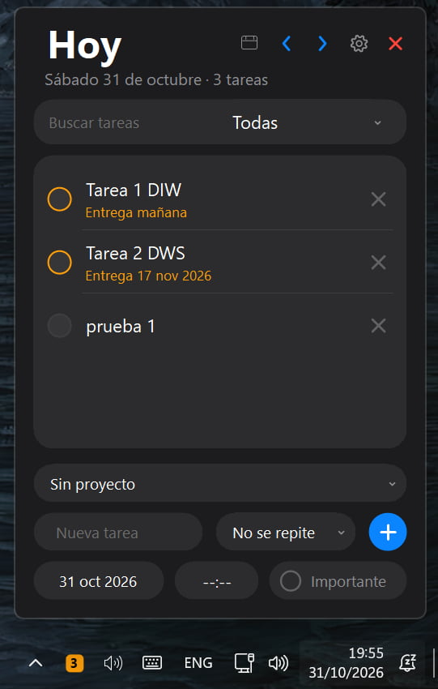
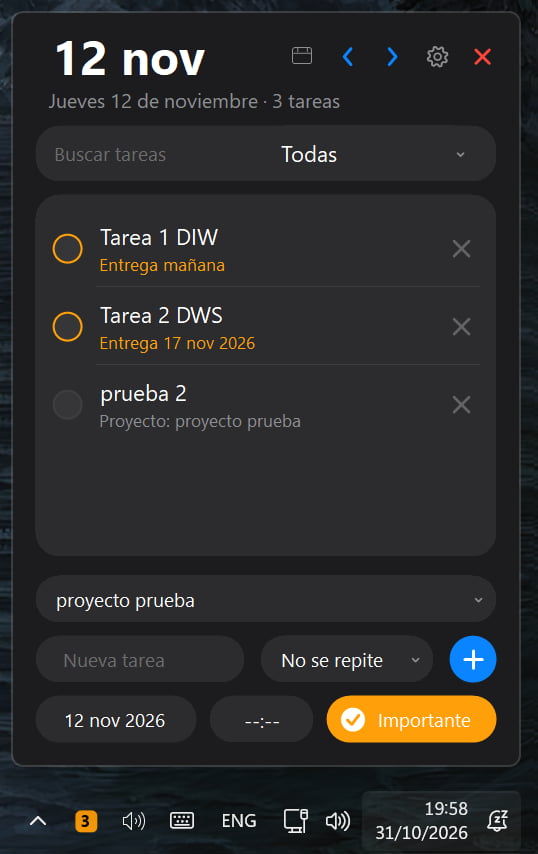
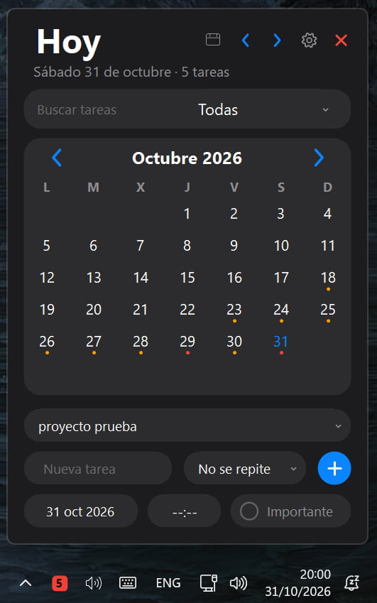
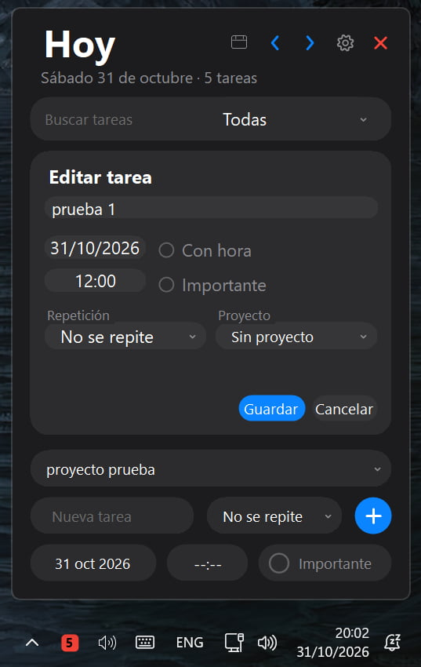
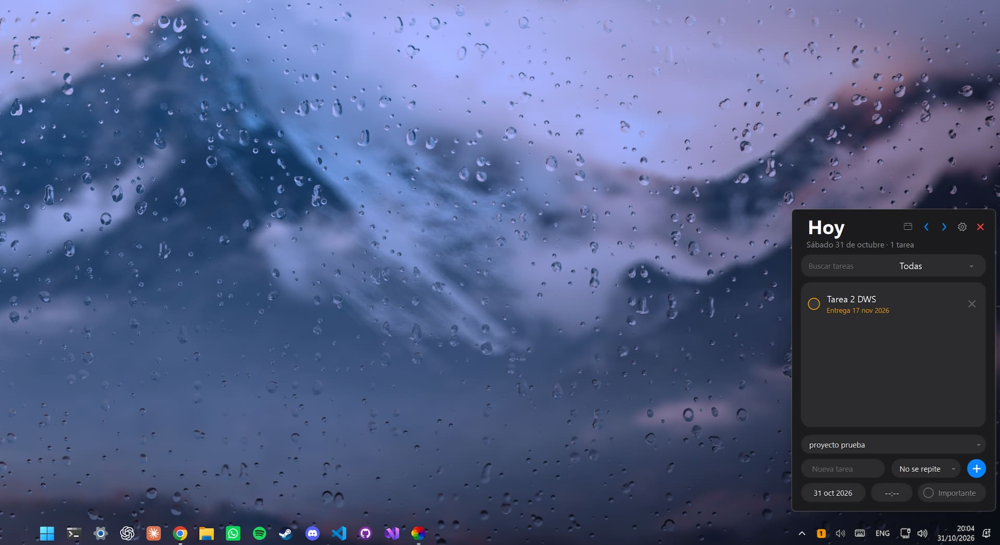

# TrayTasks

TrayTasks es una aplicación de escritorio para Windows que permite organizar tareas y recordatorios desde la bandeja del sistema.

<p align="center">
  
  
  
  
</p>
<p align="center">
  
</p>


## Funciones

- Tareas con fecha, hora e importancia.
- Repetición diaria, semanal o mensual.
- Proyectos para agrupar tareas.
- Avisos previos configurables y opción para posponerlos.
- Vista de calendario, búsqueda y filtros.
- Copia de seguridad, restauración y deshacer eliminaciones.
- Atajo de teclado, inicio con Windows y tema claro/oscuro.

## Descargar y ejecutar

Descarga el ZIP de Windows desde la sección **Releases**, extrae la carpeta completa y ejecuta `TrayTasks.exe`. Mantén la carpeta `Sounds` junto al ejecutable para conservar el sonido de las notificaciones. La publicación autocontenida incluye el runtime de .NET, por lo que no requiere instalarlo por separado.

Windows puede mostrar un aviso de SmartScreen al ejecutar una descarga nueva que todavía no tiene reputación o firma. Descarga únicamente versiones publicadas en la página oficial de Releases de este repositorio.

## Datos y privacidad

Las tareas y proyectos se guardan localmente en `%AppData%\TareasBandeja`. La aplicación no necesita una cuenta ni sincroniza los datos con un servicio en la nube. Usa **Exportar copia…** desde el menú de la bandeja para crear una copia de seguridad.

El formato de las copias, la recuperación desde respaldos y la ubicación de los registros se describen en [Datos locales y copias de seguridad](GestorTareas/GestorTareas/docs/datos-y-copias.md).

## Compilar desde el código

Se necesita el SDK de .NET 10 y Windows:

```powershell
dotnet build GestorTareas/GestorTareas.slnx -c Release
dotnet test GestorTareas/GestorTareas.slnx -c Release
```

Para generar el paquete autocontenido de 64 bits:

```powershell
dotnet publish GestorTareas/GestorTareas/GestorTareas.csproj -c Release -r win-x64 --self-contained true -o publish/TrayTasks-win-x64
```

El ZIP de distribución debe contener todo el directorio publicado, incluido `Sounds/notification.mp3`.

## Versiones

Consulta **Releases** para ver los cambios y descargar las versiones publicadas.
